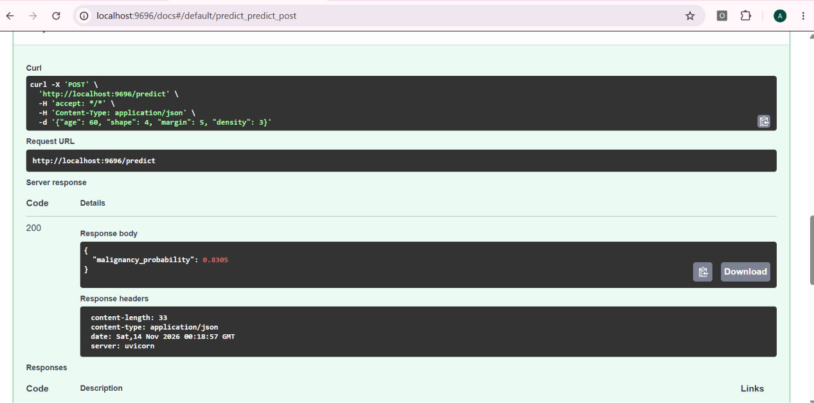

# Mammographic Mass Classification

Predicting the probability that a mammographic mass is malignant, as a decision-support aid for biopsy decisions.

*Midterm project for [ML Zoomcamp](https://github.com/DataTalksClub/machine-learning-zoomcamp) (DataTalks.Club).*

## Problem Description

When a mass is found on a mammogram, the radiologist must decide whether
to recommend a biopsy. Biopsy is an invasive procedure, and not every
mass that is biopsied turns out to be malignant. According to the dataset
description on UCI, a large share of biopsies (around 70%) turn out to be
benign. The goal of this project is to estimate the probability that a
mass is malignant from its characteristics and the patient's age, as
decision support that could help reduce unnecessary biopsies.

**Task:** binary classification (benign = 0, malignant = 1).

**Intended use:** a decision-support tool. The service receives the
characteristics of one mass and returns a malignancy probability that a
radiologist can consider alongside their own judgment. It does not replace
clinical decision-making, and no decision threshold is built into it.

## Dataset

[UCI Mammographic Mass dataset](https://archive.ics.uci.edu/dataset/161/mammographic+mass)
(CC BY 4.0): 961 cases, 516 benign and 445 malignant.

| Feature | Description | Codes |
|---------|-------------|-------|
| `age` | Patient age in years | numeric |
| `shape` | Mass shape | round=1, oval=2, lobular=3, irregular=4 |
| `margin` | Mass margin | circumscribed=1, microlobulated=2, obscured=3, ill-defined=4, spiculated=5 |
| `density` | Mass density | high=1, iso=2, low=3, fat-containing=4 |
| `severity` | **Target** | benign=0, malignant=1 |

The data is committed in this repository (`data/mammographic_mass.csv`).
It can also be re-downloaded with `src/download_data.py` (see below).

### Why BI-RADS is excluded

The original dataset also contains a `BI-RADS` assessment. It is the
radiologist's own overall rating of the case, and the UCI documentation
marks it as non-predictive. Using it as a feature would leak the
radiologist's judgment into the model (data leakage), so it is dropped.

## Exploratory Data Analysis

The full analysis is in [`notebook.ipynb`](notebook.ipynb). EDA was done on
the training portion only (768 cases, before the validation split).

- **Target:** roughly balanced (about 47% malignant in this portion).
- **Missing values** (in the full dataset): `age` 5, `shape` 31, `margin` 48, `density` 76.
- **Feature importance** (mutual information with the target): `margin` 0.185,
  `shape` 0.175, `density` 0.010. `density` is almost uninformative: nearly all
  cases have the same value (low = 3).
- **Margin and shape:** the share of malignant cases grows with irregularity.
  For example about 12.5% of cases with a circumscribed margin are malignant,
  versus about 84% of cases with a spiculated margin.
- **Age:** malignant cases are older (mean about 62.7 years vs about 49.5 for benign).

### Missing values

Missing values are kept, not dropped:
- `age` is filled with the median of the training split (57.0).
- `shape`, `margin` and `density` get their own category, `unknown`.

The same handling is applied in the prediction service.

## Models

Four models were compared with 5-fold stratified cross-validation
(ROC AUC) on the train + validation data (768 cases):

| Model | Tuned hyperparameters | CV ROC AUC (mean ± std) |
|-------|-----------------------|-------------------------|
| **Logistic regression** | `C=0.1` | **0.8746 ± 0.0273** |
| Random forest | `n_estimators=100`, `max_depth=3`, `min_samples_leaf=1` | 0.8664 ± 0.0305 |
| XGBoost | `learning_rate=0.05`, `max_depth=3`, `min_child_weight=1`, 200 rounds | 0.8569 ± 0.0295 |
| Decision tree | `max_depth=3`, `min_samples_leaf=20` | 0.8412 ± 0.0323 |

The differences between the top models are smaller than the fold-to-fold
standard deviation, so their performance is essentially comparable.
**Logistic regression was selected** because it is the simplest model, has
the highest mean AUC, and its coefficients are interpretable. The
tree-based models were tuned on the validation split (part of the CV data),
so their scores are slightly optimistic.

The final model is trained on train + validation and evaluated once on the
held-out test set (193 cases): **ROC AUC = 0.8438**.

## Project Structure

```
├── data/mammographic_mass.csv   # dataset
├── src/download_data.py         # downloads the dataset from UCI
├── notebook.ipynb               # EDA, model comparison and tuning
├── train.py                     # trains the final model, saves model.bin
├── predict.py                   # FastAPI prediction service
├── test.py                      # sends example requests to the service
├── model.bin                    # trained model (DictVectorizer, model, median age)
├── Dockerfile
├── requirements.txt             # full environment (notebook, plots, XGBoost, service)
├── requirements-docker.txt      # service-only dependencies used by the Docker image
└── README.md
```

## How to Run

### 1. Set up the environment

Developed with Python 3.13. From the project root (Windows PowerShell):

```powershell
python -m venv .venv
.\.venv\Scripts\Activate.ps1
python -m pip install -r requirements.txt
```

On macOS/Linux:

```bash
python3 -m venv .venv
source .venv/bin/activate
python -m pip install -r requirements.txt
```

Dependency versions are pinned, because `model.bin` is a pickle file and
should be loaded with the same scikit-learn version it was saved with.

### 2. Data (optional)

The CSV is already in the repository. To download it again from UCI:

```powershell
python src/download_data.py
```

### 3. Notebook

Run from the project root so the relative `data/` path works:

```powershell
jupyter notebook
```

Then open `notebook.ipynb`.

### 4. Train the model

```powershell
python train.py
```

This prints the test ROC AUC and saves `model.bin`.

### 5. Run the service locally

```powershell
uvicorn predict:app --host 127.0.0.1 --port 9696
```

Interactive docs are available at <http://localhost:9696/docs>. In a second
terminal (with the environment activated):

```powershell
python test.py
```

Example request (any field may be omitted; missing values are handled as in training):

```json
{"age": 60, "shape": 4, "margin": 5, "density": 3}
```

Example response:

```json
{"malignancy_probability": 0.8305}
```

Allowed values: `age` 0–120, `shape` 1–4, `margin` 1–5, `density` 1–4.



### 6. Run with Docker

```powershell
docker build -t mammographic-mass .
docker run -p 9696:9696 mammographic-mass
```

The service is then available on port 9696, exactly as in the local run
(`python test.py` works unchanged). The image installs only the dependencies
in `requirements-docker.txt` and copies `predict.py` and `model.bin`.
Tested with Docker Desktop on Windows.

## Limitations

- The data comes from a single institution (2003–2006). The model has not
  been validated on other populations or on modern equipment, so it is
  **not ready for clinical use**.
- The dataset is small (961 cases), and the test set has only 193 cases, so
  the test AUC has a wide uncertainty. This is why cross-validation was
  used to compare models.
- Only ROC AUC was evaluated. Calibration of the probabilities and the
  choice of a decision threshold were not studied.
- `BI-RADS` is excluded on purpose (see above), which makes the task
  harder but avoids leakage.
- The model is linear in age, so ages outside the range seen in training (about 19–96 years) are extrapolated and should not be trusted.  

## Cloud deployment

Not done (optional in the course).

## Data source and license

UCI Machine Learning Repository, Mammographic Mass dataset (CC BY 4.0);
see the dataset page for the original citation (Elter et al.).